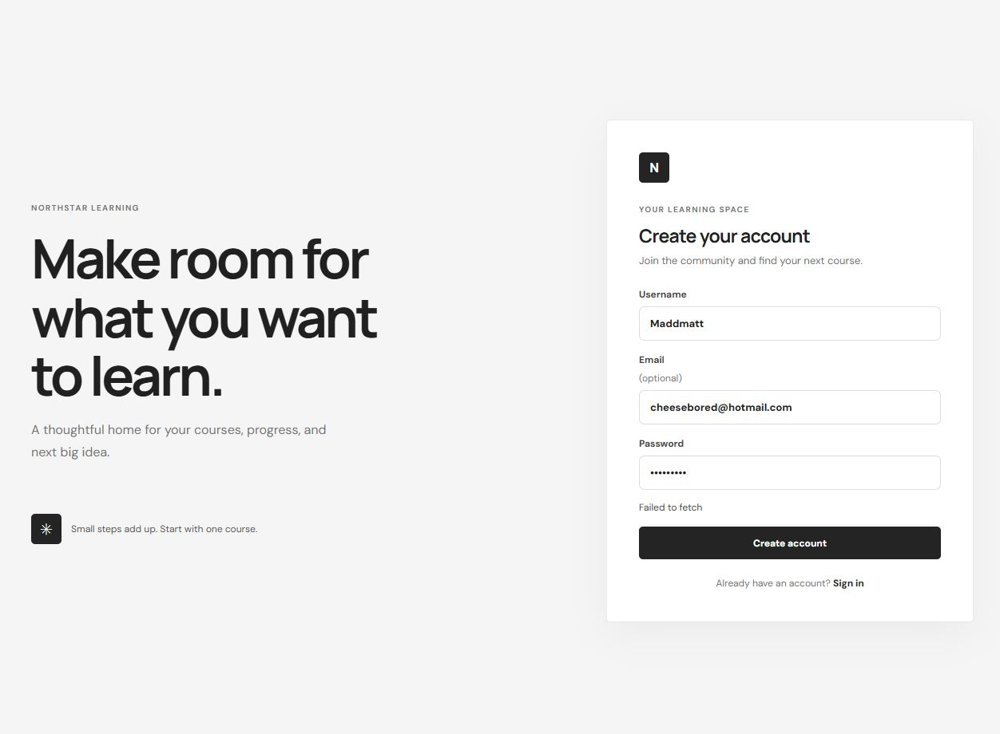

# Northstar Learning

Northstar Learning is a full-stack learning management system starter. Students can discover courses and manage their enrollments; teachers can publish courses; administrators can manage users and course data through Django Admin. The project uses Django REST Framework and SQLite on the backend, with a responsive React frontend.

## Splash page concept



## Project layout

```text
backend/
  accounts/       Custom user model, registration, role and authentication API
  courses/        Courses, enrollments, permissions and API tests
  config/         Django settings and API routing
frontend/
  src/            React application, API client, styles and component tests
```

## Wireframe

The initial desktop dashboard uses a persistent left navigation rail and a content area. On mobile, the navigation moves above the page content.

```text
┌─────────────────────┬──────────────────────────────────────────────────┐
│ N northstar.        │ Workspace / Overview               Today · Avatar│
│                     ├──────────────────────────────────────────────────┤
│ LEARNING            │ Good to see you, learner       [Find a course]   │
│  Overview           │ A little progress each day adds up.              │
│  Explore courses    │                                                  │
│  My learning        │ [In progress]   [Your role]     [Note to self]   │
│                     │                                                  │
│                     │ Picked for your next step       [View all →]     │
│ Keep your momentum  │ [Course card]    [Course card]   [Course card]   │
│ Learner · Sign out  │                                                  │
└─────────────────────┴──────────────────────────────────────────────────┘
```

The sign-in and account-creation screens use the same restrained monochrome palette of black, white and muted grays. Course and account forms have visible labels, keyboard focus indicators, responsive layouts and accessible status/error messages.

## Technology and dependencies

| Library/tool | Use | Source |
| --- | --- | --- |
| [Django](https://www.djangoproject.com/) | Backend framework, ORM, sessions and administration | [Django documentation](https://docs.djangoproject.com/) |
| [Django REST Framework](https://www.django-rest-framework.org/) | REST serializers, views, permissions and API testing | [DRF documentation](https://www.django-rest-framework.org/) |
| [Simple JWT](https://django-rest-framework-simplejwt.readthedocs.io/) | JWT authentication endpoints | [Simple JWT documentation](https://django-rest-framework-simplejwt.readthedocs.io/) |
| [django-cors-headers](https://github.com/adamchainz/django-cors-headers) | Local React-to-Django cross-origin requests | [Project documentation](https://github.com/adamchainz/django-cors-headers) |
| [React](https://react.dev/) | Frontend interface and component state | [React documentation](https://react.dev/learn) |
| [Vite](https://vite.dev/) | Frontend development server and production bundling | [Vite documentation](https://vite.dev/guide/) |
| [Vitest](https://vitest.dev/) and [React Testing Library](https://testing-library.com/docs/react-testing-library/intro/) | Frontend component tests | [Vitest guide](https://vitest.dev/guide/) |
| [Google Fonts: DM Sans and Manrope](https://fonts.google.com/) | Optional UI typography, with system sans-serif fallbacks | [Google Fonts](https://fonts.google.com/) |

## Requirements

- Python 3.10 or later
- Node.js 20.19+ or 22.12+
- npm (included with Node.js)

## Run locally

Open two terminals from the repository root.

### 1. Start the Django API

```powershell
py -m venv .venv
.\.venv\Scripts\Activate.ps1
pip install -r backend\requirements.txt
cd backend
py manage.py makemigrations accounts courses
py manage.py migrate
py manage.py createsuperuser
py manage.py runserver
```

The API is available at `http://127.0.0.1:8000/api/`; the Django administration site is at `http://127.0.0.1:8000/admin/`. Use the admin site to change a user's role to `teacher` or manage users and courses. A superuser is automatically assigned the `admin` role.

If PowerShell does not allow virtual environment activation, use `.\.venv\Scripts\python.exe` in place of `py` for the Django commands.

### 2. Start the React client

```powershell
cd frontend
npm install
npm run dev
```

Open the Vite URL shown in the terminal (normally `http://localhost:5173`). The frontend expects the API at `http://127.0.0.1:8000/api` by default. To use a different API URL, copy `frontend/.env.example` to `frontend/.env` and set `VITE_API_URL`.

For local backend configuration, use `backend/.env.example` as a reference for the variables to set in your shell. Django does not load `.env` files automatically; export the values before starting the server. The fallback secret key and debug setting are for local development only.

## How it works

### Authentication and roles

The backend uses a custom Django `User` model with `student`, `teacher`, and `admin` roles. Registration always creates a student; the requested role is read-only and cannot be used to grant privileges. Login issues a short-lived JWT access token. The React client sends it as a Bearer token for authenticated API requests and asks `/api/auth/me/` for the active user's role.

The frontend stores the access token in browser local storage for this starter. Production deployments should assess the security trade-offs and consider an HttpOnly cookie strategy, HTTPS, secret management, and refresh-token rotation.

### Courses and enrollment

Courses belong to their creating teacher. Authenticated teachers can create, update, and delete their own courses; administrators can manage all courses. The catalog is publicly readable. Students can enroll in and leave courses, and the database enforces one enrollment per student/course pair. Students only receive their own enrollment list.

SQLite is configured as the local relational database at `backend/db.sqlite3`. The database file is ignored by Git.

## API overview

All endpoints are under `/api/`. Protected endpoints require `Authorization: Bearer <access-token>`.

| Method | Endpoint | Access | Purpose |
| --- | --- | --- | --- |
| `POST` | `/auth/register/` | Public | Register a student account |
| `POST` | `/auth/token/` | Public | Obtain JWT access and refresh tokens |
| `POST` | `/auth/token/refresh/` | Public | Refresh an access token |
| `GET` | `/auth/me/` | Authenticated | Get the current user's profile and role |
| `GET` | `/courses/` | Public | Browse the course catalog |
| `POST` | `/courses/` | Teacher/admin | Create a course |
| `GET`, `PUT`, `PATCH`, `DELETE` | `/courses/{id}/` | Public read; owner teacher/admin write | Read or manage a course |
| `POST` | `/courses/{id}/enroll/` | Student | Enroll in a course |
| `DELETE` | `/courses/{id}/unenroll/` | Student | Leave a course |
| `GET` | `/enrollments/` | Authenticated student | List the current student's enrollments |

User administration is provided by Django Admin at `/admin/`.

## Tests and build

Run backend integration tests from `backend/`:

```powershell
py manage.py test
```

Run frontend component tests and a production build from `frontend/`:

```powershell
npm test
npm run build
```

The backend tests cover student-only registration, public course browsing, enrollment uniqueness, student write restrictions, and teacher ownership. React Testing Library tests cover sign-in and the dashboard, registration UI, and visible API errors.

## Deployment notes

This starter is configured for local development and is not production-hardened. Before deployment, set `DJANGO_SECRET_KEY`, `DJANGO_DEBUG=false`, `DJANGO_ALLOWED_HOSTS`, and `CORS_ALLOWED_ORIGINS` explicitly; serve over HTTPS; configure a persistent production database; and review token storage, logging, backups, and static asset delivery. No live deployment is configured yet.

## License

This project is available under the MIT License. See [LICENSE](LICENSE).
